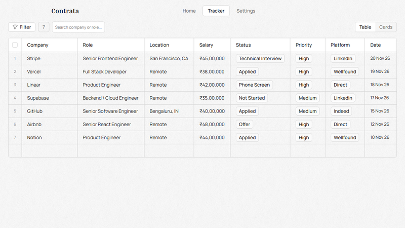

# 📋 Contrata

<p align="center">
  
</p>

A minimalist, outline-based job application workflow & pipeline tracker.  
**Contrata** bridges the gap between AI job discovery and disciplined application tracking—combining a 4-step Claude + Apify scraping prompt pipeline with a high-density, tactile local-first tracker.

[](https://react.dev/)
[](https://vite.dev/)
[](https://tailwindcss.com/)
[](https://github.com/pmndrs/zustand)
[](https://reactrouter.com/)
[](https://oxc.rs/)

---

## ✨ Features & Highlights

### 🧭 Intelligent 4-Step Application Pipeline
- **1️⃣ Context**: Input your candidate background, core skills, projects, and achievements. Generate standardized, structured context prompts for LLMs with a single click.
- **2️⃣ Preferences**: Define target parameters including job titles, location modes (Remote, Hybrid, Onsite), experience tier, and minimum salary thresholds to generate precision scraping prompts.
- **3️⃣ Response**: Ingest structured JSON opportunities retrieved from Claude paired with [Apify MCP connectors](https://blog.apify.com/announcing-mcp-connectors/) without manual copy-pasting.
- **4️⃣ Next Steps**: Review parsed opportunities, filter match scores, and instantly populate your active tracker.

### 📊 Dual Tracker Layouts
- **High-Density Table View**:
  - Full keyboard navigation and inline editing for company, role, location, salary, status, priority, and notes.
  - Multi-select checkboxes for batch operations (Save, Archive, Delete).
  - Column sorting by date posted, match score, salary, and company name.
- **Kanban Cards View**:
  - Clean card representations showcasing match percentages, salary tags, platform badges, and direct application links.

### 🏷️ Complete Application Lifecycle Management
- **Stage Tracking**: Monitor jobs across seven distinct phases:
  - `Not Started` • `Applied` • `Phone Screen` • `Technical Interview` • `Onsite Interview` • `Offer` • `Rejected`
- **Priority & Platform Tagging**:
  - Priority levels: `High`, `Medium`, and `Low` based on role fit.
  - Sources: `LinkedIn`, `Indeed`, `Wellfound`, `Direct`, `Referral`, `Glassdoor`, and `Other`.
- **Interactive Job Drawer**: Click into any entry to slide open the complete role description, personal notes, compensation details, and primary URLs.

### 🔍 Real-Time Multi-Axis Filtering
- Search instantly across company names and role titles.
- Filter by application status, priority rating, platform source, and location model.
- Dynamic salary range slider to highlight roles meeting your compensation floor.

### 💾 Local-First & Data Sovereignty
- **Private by Default**: 100% client-side storage via reactive LocalStorage hooks. No telemetry, no backend tracking.
- **Backup & Restore**: Export your entire application pipeline to a structured JSON file at any time, or import existing datasets seamlessly.

### 🎨 Outline & Paper Design System
- Built on a minimal, zero-shadow, entirely outline-based design language.
- Tactile paper backdrop (`#FAFAF9`) paired with serif typography and clean borders, engineered to eliminate visual distraction during intense interview sprints.

---

## 🛠 Tech Stack

### Frontend & Core
- **Framework**: React 19 (Modern Hooks, functional architecture)
- **Build Tool**: Vite 8 (Ultra-fast development server & optimized production bundles)
- **Styling**: Tailwind CSS v4 (`@tailwindcss/vite`)
- **State Management**: Zustand 5 + Reactive LocalStorage persistence
- **Routing**: React Router v7
- **Icons**: `@heroicons/react`
- **Markdown Rendering**: `react-markdown`

### Code Quality & Standards
- **Linter**: Oxlint (High-performance Rust-based linter)
- **Formatter**: Prettier with `prettier-plugin-tailwindcss`

---

## 📂 Directory Structure

```text
🌟 contrata/
├── 📁 public/                     # Static assets
│   └── favicon.svg                # Application branding icon
│
├── 📁 src/                        # Application source code
│   ├── 📁 components/             # Reusable UI & view modules
│   │   ├── Navbar.jsx             # Top bar navigation & logo
│   │   ├── 📁 home/               # 4-step pipeline workflow
│   │   │   ├── ContextStep.jsx    # Candidate background & prompt generator
│   │   │   ├── PreferencesStep.jsx # Target criteria & scraper prompt generator
│   │   │   ├── ResponseStep.jsx   # Scraped JSON parser & ingestor
│   │   │   ├── NextSteps.jsx      # Pipeline progression & navigation
│   │   │   └── SmartLinkStore.jsx # Smart link helper component
│   │   │
│   │   ├── 📁 tracker/            # Application tracker engine
│   │   │   ├── JobDetailsSidebar.jsx # Slide-over role details drawer
│   │   │   ├── SalaryRangeFilter.jsx # Interactive compensation filter
│   │   │   ├── TrackerAddRow.jsx  # Rapid inline job creation row
│   │   │   ├── TrackerCards.jsx   # Kanban card layout view
│   │   │   ├── TrackerFilterPanel.jsx # Multi-select filter popover
│   │   │   └── TrackerTable.jsx   # High-density editable data table
│   │   │
│   │   ├── 📁 settings/           # User configuration & backups
│   │   │   ├── SettingsDataExport.jsx # JSON import/export & reset handlers
│   │   │   ├── SettingsOptionsCard.jsx # Tracker configuration options
│   │   │   └── SettingsPreferencesCard.jsx # Search default preferences
│   │   │
│   │   └── 📁 ui/                 # Outline-based design primitives
│   │       ├── Badge.jsx          # Tag & status badge primitive
│   │       ├── BadgeDropdown.jsx  # Selectable badge popover
│   │       ├── Button.jsx         # Accessible button component
│   │       ├── Calendar.jsx       # Calendar picker primitive
│   │       ├── Card.jsx           # Outline card container
│   │       ├── Checkbox.jsx       # Custom form checkbox
│   │       ├── ContextMenu.jsx    # Right-click contextual actions
│   │       ├── DatePicker.jsx     # Date selection input
│   │       ├── Dropdown.jsx       # Floating menu primitive
│   │       ├── EditableCell.jsx   # In-place table cell editor
│   │       ├── EditableSpan.jsx   # Inline text modifier
│   │       ├── Icons.jsx          # Custom SVG icon set
│   │       ├── Input.jsx          # Text field primitive
│   │       ├── ListItem.jsx       # Standardized list row
│   │       ├── RangeInput.jsx     # Min/max slider control
│   │       ├── Select.jsx         # Custom select picker
│   │       ├── Table.jsx          # Semantic table container
│   │       ├── Tabs.jsx           # Floating pill tab switcher
│   │       ├── Timeline.jsx       # Step-by-step numbered timeline
│   │       └── Tooltip.jsx        # Hover info container
│   │
│   ├── 📁 data/                   # Default datasets and schemas
│   │   ├── card.json              # Schema definition for job entities
│   │   ├── homeTimeline.json      # Step definitions and guide notes
│   │   ├── navigation.json        # Header route items
│   │   ├── table.json             # Table column specifications
│   │   └── trackerConfig.js       # Status, priority & platform constants
│   │
│   ├── 📁 hooks/                  # Custom React hooks
│   │   ├── useCalendar.js         # Date formatting & calendar state
│   │   ├── useHomeTimeline.js     # Home tab & step switcher
│   │   ├── useLocalStorage.js     # Reactive browser storage hook
│   │   ├── useOutsideClick.js     # Popover dismissal helper
│   │   ├── usePreferences.js      # Filter & preference persistence
│   │   ├── useTrackerEngine.js    # Core job filtering, sorting & CRUD engine
│   │   ├── useTrackerOptions.js   # Dynamic tag option manager
│   │   └── useTrackerTable.js     # Table selection and sorting
│   │
│   ├── 📁 pages/
│   │   ├── Home.jsx               # 4-step guided application pipeline
│   │   ├── Tracker.jsx            # Pipeline table & card dashboard
│   │   ├── Settings.jsx           # Data export/import & preferences
│   │   └── Styling.jsx            # Design system component showcase
│   │
│   ├── 📁 utils/
│   │   ├── formatters.js          # Currency, date, and text formatters
│   │   ├── links.js               # External link sanitizers
│   │   ├── prompts.js             # Claude & Apify scraping prompt templates
│   │   ├── salary.js              # Salary parsing & normalization
│   │   └── storage.js             # LocalStorage wrapper
│   │
│   ├── App.jsx                    # Root routing & layout container
│   ├── index.css                  # Paper theme & Tailwind directives
│   └── main.jsx                   # React root mount point
│
├── .oxlintrc.json                 # Oxlint configuration
├── index.html                     # HTML document shell
├── package.json                   # Project scripts and dependencies
├── README-img.png                 # Interface preview screenshot
├── README.md                      # Project documentation
└── vite.config.js                 # Vite bundler configuration
```

---

## 📄 Getting Started

Follow these steps to set up and run Contrata locally:

### 1️⃣ Clone the Repository
```bash
git clone https://github.com/yashthorat7/contrata.git
cd contrata
```

### 2️⃣ Install Dependencies
```bash
npm install
```

### 3️⃣ Start the Development Server
```bash
npm run dev
```

Open `http://localhost:5173` in your browser.

---

## 💡 The Contrata Workflow

Contrata is founded on a key principle: **The job search is a marathon, and automated apply bots do more harm than good.**

Many ATS platforms now employ bot detection mechanisms that can lead to account bans or instant disqualification. Manual, customized applications remain the highest-signal way to land premier engineering offers.

```text
┌─────────────────┐       ┌─────────────────┐       ┌─────────────────┐       ┌─────────────────┐
│   1. Context    │ ───>  │ 2. Preferences  │ ───>  │  3. Response    │ ───>  │   4. Tracker    │
│ Paste Candidate │       │ Configure Target│       │ Paste Scraped   │       │ Manage Stages,  │
│ Resume & Skills │       │ Role Criteria   │       │ JSON from Apify │       │ Interviews & DD │
└─────────────────┘       └─────────────────┘       └─────────────────┘       └─────────────────┘
```

1. **Context**: Format your core strengths into a reusable system prompt.
2. **Preferences**: Generate an actionable Apify scraping prompt for Claude.
3. **Response**: Ingest clean, deduplicated job postings directly into Contrata.
4. **Tracker**: Prioritize, apply manually, track outreach, and close offers.

---

## ❤️ Developed By

👨‍💻 **Yash Thorat**  
Feel free to suggest improvements, or report issues!

⭐ Don't forget to **star** this repository if you find it useful!
